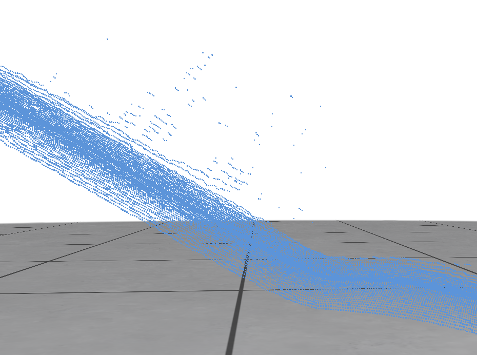
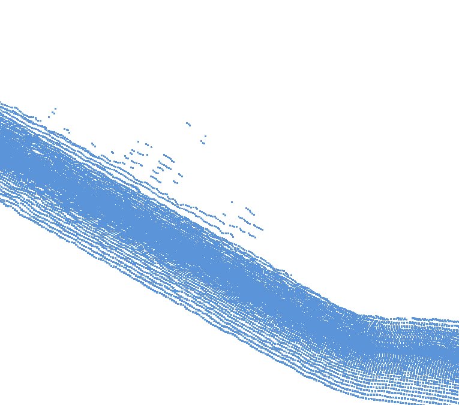
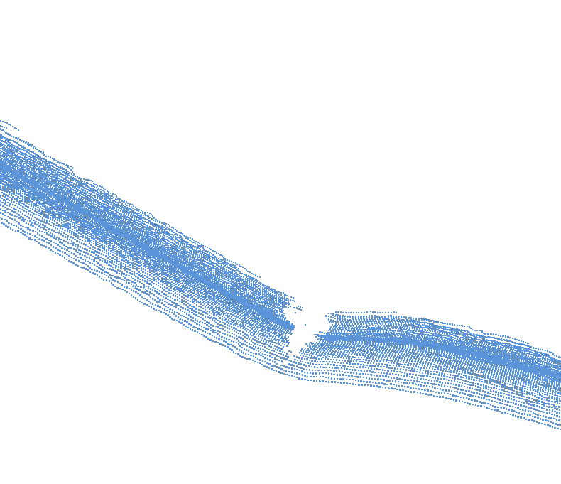

## Author :
Cassiopée Gossin - M2 CMI informatique  
2026 - 2027

### Fork :
This project is forked from [PointCloudCurvCNC](https://github.com/JacquesOlivierLachaud/PointCloudCurvCNC). 

# Filter and reconstruction project 
## About :
This is a course project about 3D reconstruction.  
The goal is to find ways to filter or move points from a point cloud to remove outliers and reconstruct the 3D model as accurately as possible.  

## Reading progress :
To learn more about various reconstructions technics, I'm reading many scientific papers, thesis and publications.  
This is a summary of what I read or what I plan to read.  

| Name | Authors | To read | Reading | Read |
| ------------------ | ------------------ | ------------------ | ------------------ | ------------------ | 
| [Advancing Front Surface Reconstruction](https://doc.cgal.org/latest/Advancing_front_surface_reconstruction/index.html) | Tran Kai Frank Da, David Cohen-Steiner | X |  |  |
| [Algebraic Point Set Surface](https://dl.acm.org/doi/pdf/10.1145/1276377.1276406) | Gael Guennebaud, Markus Gross |  |  | X |
| [Cocone](https://dl.acm.org/doi/pdf/10.1145/378583.378682) | Tamal K. Dey, Joachim Giesen | X |  |  |
| [Dual Contouring](https://dl.acm.org/doi/pdf/10.1145/566570.566586) | Tao Ju, Frank Losasso, Scott Schaefer, Joe Warren |  |  | X |
| [Efficient Surface Normal Estimation for LiDAR Point Clouds](https://media.eventhosts.cc/Conferences/ECCV2026/pdfs/12046.pdf) | Kohei Matsuzaki, Keisuke Nonaka |  | X |  |
| [LiDAR Aquisition (fr)](https://hal.univ-lyon2.fr/GDR_MACS/tel-03215906v1) | Quentin Pentek | X |  |  |
| [Marching Cube](https://dl.acm.org/doi/pdf/10.1145/37402.37422) | William E. Lorensen, Harvey E. Cline |  |  | X |
| [Poisson Reconstruction](https://www.cse.iitb.ac.in/~cs749/spr2016/handouts/kazhdan_poisson.pdf) | Michael Kazhdan, Matthew Bolitho, Hugues Hoppe |  |  | X |
| [Robust Cocone](https://dl.acm.org/doi/pdf/10.1145/997817.997867) | Tamal K. Dey, Samrat Goswami | X |  |  |
| [Scale-Space Surface Reconstruction](https://doc.cgal.org/latest/Scale_space_reconstruction_3/index.html#Chapter_Scale_space_reconstruction) | Thijs van Lankveld | X |  |  |
| [Super Cocone](https://etd.ohiolink.edu/acprod/odb_etd/ws/send_file/send?accession=osu1732009886712661&disposition=inline) | James Hudson | X |  |  |
| [Tight Cocone](https://dl.acm.org/doi/pdf/10.1145/781606.781627) | Tamal K. Dey, Samrat Goswami | X |  |  |
| [Winding Number](https://dl.acm.org/doi/pdf/10.1145/3197517.3201337) | Gavin Barill, Neil G. Dickson, Ryan Schmidt, David I.W. Levin, Alec Jacobson |  |  | X |

## Code progress : 
### Naive Filter :
First I tried a naive version to filter points. This function create, for each point, an average point from many points around it. If the point we are looking at is too far from the average point, it's errased. The number of point taken into account to create the average point and the maximum accepted distance are decided by the user.  
The goal of this first filter is to erase isolated outliers. 

<u>**Results :**</u>  

| |  |  |
| ---- | ---- | ---- |
| Before (no changes) | After : 10 neighbour and 5 max distance | After : 100 neighbour and 0.5 max distance |  

<u>**Pros :**</u>
- We can see some results 

<u>**Cons :**</u>
- Too naive and not optimised
- Can erase no-outliers points
- Inefficient finding neighbour technique

<u>**Conclusion :**</u>  
This version is not robust enough to give it serious consideration. 

### Other methods in progress ... 
