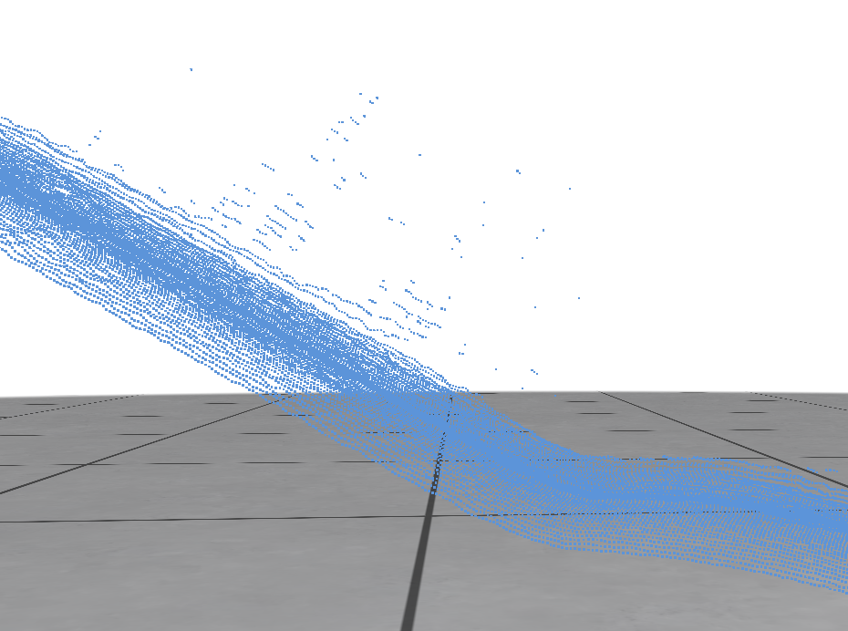
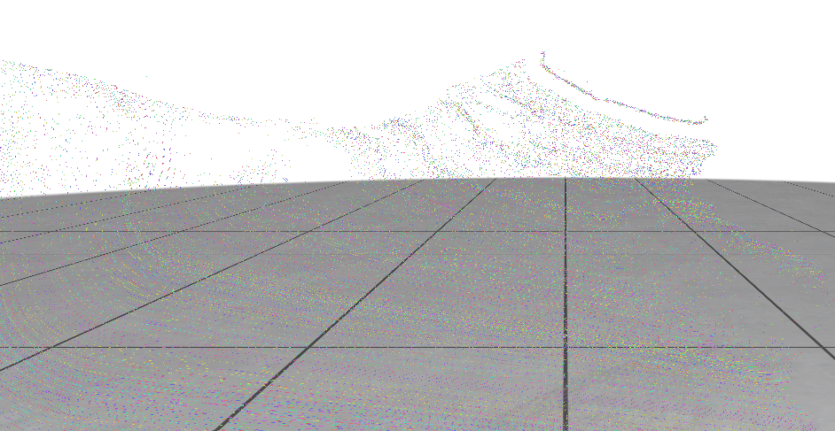
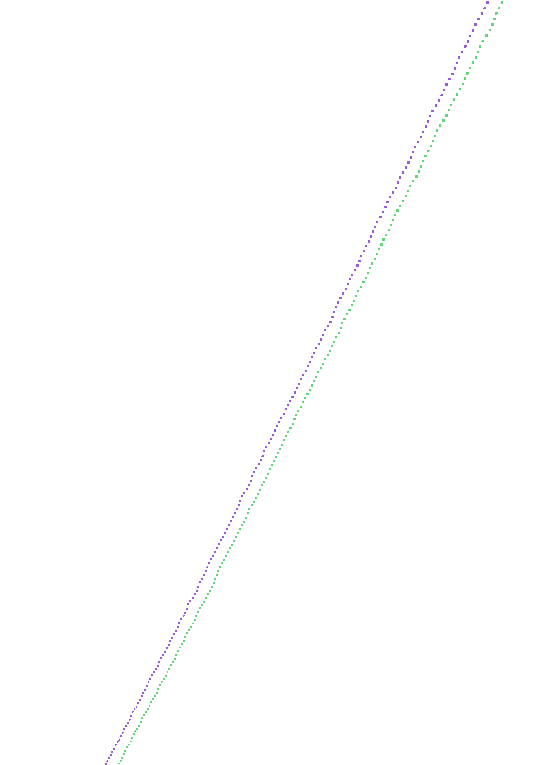
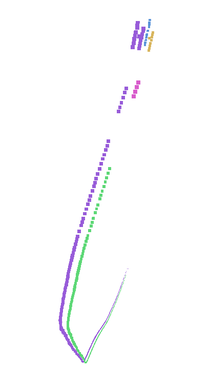

## Author :
Cassiopée Gossin - M2 CMI informatique  
2026 - 2027

### Fork :
This project is forked from [PointCloudCurvCNC](https://github.com/JacquesOlivierLachaud/PointCloudCurvCNC). 

# Filter and reconstruction project 
## About :
This is a course project about 3D reconstruction.  
The goal is to find ways to filter or move points from a point cloud to remove outliers and reconstruct the 3D model as accurately as possible.  

## Reading progress :
To learn more about various reconstructions technics, I'm reading many scientific papers, thesis and publications.  
This is a summary of what I read or what I plan to read.  

| Name | Authors | To read | Reading | Read |
| ------------------ | ------------------ | ------------------ | ------------------ | ------------------ | 
| [Advancing Front Surface Reconstruction](https://doc.cgal.org/latest/Advancing_front_surface_reconstruction/index.html) | Tran Kai Frank Da, David Cohen-Steiner |  |  | X |
| [Algebraic Point Set Surface](https://dl.acm.org/doi/pdf/10.1145/1276377.1276406) | Gael Guennebaud, Markus Gross |  |  | X |
| [3D Alpha Shape](https://doc.cgal.org/latest/Alpha_shapes_3/index.html) | Tran Kai Frank Da, Sébastien Loriot, Mariette Yvinec |  |  | X |
| [Cocone](https://dl.acm.org/doi/pdf/10.1145/378583.378682) | Tamal K. Dey, Joachim Giesen | X |  |  |
| [Dual Contouring](https://dl.acm.org/doi/pdf/10.1145/566570.566586) | Tao Ju, Frank Losasso, Scott Schaefer, Joe Warren |  |  | X |
| [Efficient Surface Normal Estimation for LiDAR Point Clouds](https://media.eventhosts.cc/Conferences/ECCV2026/pdfs/12046.pdf) | Kohei Matsuzaki, Keisuke Nonaka |  |  | X |
| [Estimating Discrete Total Curvature with Per Triangle Normal Variation](https://cranehechen.com/files/total_curvature_paper_small.pdf) | Crane He Chen | X |  |  |
| [High-quality Point Cloud Oriented Normal Estimation via Hybrid Angular and Euclidean Distance Encoding](https://openaccess.thecvf.com/content/CVPR2025/papers/Li_High-quality_Point_Cloud_Oriented_Normal_Estimation_via_Hybrid_Angular_and_CVPR_2025_paper.pdf) | Yuanqi Li & al. | X |  |  |
| [LiDAR Aquisition (fr)](https://hal.univ-lyon2.fr/GDR_MACS/tel-03215906v1) | Quentin Pentek |  | X |  |
| [Marching Cube](https://dl.acm.org/doi/pdf/10.1145/37402.37422) | William E. Lorensen, Harvey E. Cline |  |  | X |
| [Point Cloud Normal Estimation via Representation Learning on Height Maps](https://dl.acm.org/doi/pdf/10.1145/3696409.3700185) | Yang Yi & al. | X |  |  |
| [Poisson Reconstruction](https://www.cse.iitb.ac.in/~cs749/spr2016/handouts/kazhdan_poisson.pdf) | Michael Kazhdan, Matthew Bolitho, Hugues Hoppe |  |  | X |
| [Robust Cocone](https://dl.acm.org/doi/pdf/10.1145/997817.997867) | Tamal K. Dey, Samrat Goswami | X |  |  |
| [Scale-Space Surface Reconstruction](https://doc.cgal.org/latest/Scale_space_reconstruction_3/index.html#Chapter_Scale_space_reconstruction) | Thijs van Lankveld |  |  | X |
| [Super Cocone](https://etd.ohiolink.edu/acprod/odb_etd/ws/send_file/send?accession=osu1732009886712661&disposition=inline) | James Hudson | X |  |  |
| [Surface Reconstruction from 3D Point Clouds via Geometry-guided Distance Representation](https://openaccess.thecvf.com/content/ICCV2023/papers/Ren_GeoUDF_Surface_Reconstruction_from_3D_Point_Clouds_via_Geometry-guided_Distance_ICCV_2023_paper.pdf) | Siyu Ren & al. | X |  |  |
| [Surface Reconstruction from Point Cloud using a Semi-Lagrangian Scheme with Local Interpolator](https://link.springer.com/content/pdf/10.1007/s10915-025-02843-y.pdf) | Silvia Preda, Matteo Semplice | X |  |  |
| [Tight Cocone](https://dl.acm.org/doi/pdf/10.1145/781606.781627) | Tamal K. Dey, Samrat Goswami | X |  |  |
| [Winding Number](https://dl.acm.org/doi/pdf/10.1145/3197517.3201337) | Gavin Barill, Neil G. Dickson, Ryan Schmidt, David I.W. Levin, Alec Jacobson |  |  | X |

## Code progress : 
### Naive Filter :
First I tried a naive version to filter points. This function create, for each point, an average point from many points around it. If the point we are looking at is too far from the average point, it's errased. The number of point taken into account to create the average point and the maximum accepted distance are decided by the user.  
The goal of this first filter is to erase isolated outliers. 

<u>**Results :**</u>  

| |  |  |
| ---- | ---- | ---- |
| Before (no changes) | After : 10 neighbour and 5 max distance | After : 100 neighbour and 0.5 max distance |  

<u>**Pros :**</u>
- We can see some results 

<u>**Cons :**</u>
- Too naive and not optimised
- Can erase no-outliers points
- Inefficient finding neighbour technique

<u>**Conclusion :**</u>  
This version is not robust enough to give it serious consideration. 

### Cut data in lines :
To separate data as effectively as possible, I cut data in LiDAR lines. This function read all data points in the order they appear in the tab. For each read point, I calculate the distance between this point and the next one. If a distance between 2 point is greater than the mean distance for this line multiply by delta, then this means we changed line. The line previously read is stocked as a line, and we continue until the end of all points.
Then, to display all line, we create multiple point cloud we are displaying in space. Each point cloud have its own color.  
The goal is to separate line to facilitate futur computations.  

<u>**Results :**</u>  

| |  |  |  |  |
| ---- | ---- | ---- | ---- | ---- |
| Before (no changes) | After : delta = 7, 4489 lines found, focus on all datas (each color is a line) | After : delta = 4, 7010 lines found, focus on 2 lines | After : delta = 4, 7010 lines found, focus on 2 lines | After : delta = 4, 7010 lines found, focus on the first 5 lines (we can see really small lines in pink, blue and yellow) | 

<u>**Pros :**</u>
- It's working
- Lines are well cut
- Quite fast

<u>**Cons :**</u>
- Can create really small lines, depending of the choosen delta (see fifth image)
- Can be hard to display with all lines as point cloud 

<u>**Conclusion :**</u>  
These cuts in data will be useful and used in futur computation.

### Other methods in progress ... 
