## Author :
Cassiopée Gossin - M2 CMI informatique  
2026 - 2027

### Fork :
This project is forked from [PointCloudCurvCNC](https://github.com/JacquesOlivierLachaud/PointCloudCurvCNC). 

# Filter and reconstruction project 
## About :
This is a course project about 3D reconstruction.  
The goal is to find ways to filter or move points from a point cloud to remove outliers and reconstruct the 3D model as accurately as possible.  

## Reading progress :
To learn more about various reconstructions technics, I'm reading many scientific papers, thesis and publications.  
This is a summary of what I read or what I plan to read.  

| Name | Authors | To read | Reading | Read |
| ------------------ | ------------------ | ------------------ | ------------------ | ------------------ | 
| [Advancing Front Surface Reconstruction](https://doc.cgal.org/latest/Advancing_front_surface_reconstruction/index.html) | Tran Kai Frank Da, David Cohen-Steiner |  |  | X |
| [Algebraic Point Set Surface](https://dl.acm.org/doi/pdf/10.1145/1276377.1276406) | Gael Guennebaud, Markus Gross |  |  | X |
| [3D Alpha Shape](https://doc.cgal.org/latest/Alpha_shapes_3/index.html) | Tran Kai Frank Da, Sébastien Loriot, Mariette Yvinec |  |  | X |
| [Cocone](https://dl.acm.org/doi/pdf/10.1145/378583.378682) | Tamal K. Dey, Joachim Giesen | X |  |  |
| [Dual Contouring](https://dl.acm.org/doi/pdf/10.1145/566570.566586) | Tao Ju, Frank Losasso, Scott Schaefer, Joe Warren |  |  | X |
| [Efficient Surface Normal Estimation for LiDAR Point Clouds](https://media.eventhosts.cc/Conferences/ECCV2026/pdfs/12046.pdf) | Kohei Matsuzaki, Keisuke Nonaka |  |  | X |
| [Estimating Discrete Total Curvature with Per Triangle Normal Variation](https://cranehechen.com/files/total_curvature_paper_small.pdf) | Crane He Chen | X |  |  |
| [High-quality Point Cloud Oriented Normal Estimation via Hybrid Angular and Euclidean Distance Encoding](https://openaccess.thecvf.com/content/CVPR2025/papers/Li_High-quality_Point_Cloud_Oriented_Normal_Estimation_via_Hybrid_Angular_and_CVPR_2025_paper.pdf) | Yuanqi Li & al. | X |  |  |
| [LiDAR Aquisition (fr)](https://hal.univ-lyon2.fr/GDR_MACS/tel-03215906v1) | Quentin Pentek |  | X |  |
| [Marching Cube](https://dl.acm.org/doi/pdf/10.1145/37402.37422) | William E. Lorensen, Harvey E. Cline |  |  | X |
| [Point Cloud Normal Estimation via Representation Learning on Height Maps](https://dl.acm.org/doi/pdf/10.1145/3696409.3700185) | Yang Yi & al. | X |  |  |
| [Poisson Reconstruction](https://www.cse.iitb.ac.in/~cs749/spr2016/handouts/kazhdan_poisson.pdf) | Michael Kazhdan, Matthew Bolitho, Hugues Hoppe |  |  | X |
| [Robust Cocone](https://dl.acm.org/doi/pdf/10.1145/997817.997867) | Tamal K. Dey, Samrat Goswami | X |  |  |
| [Scale-Space Surface Reconstruction](https://doc.cgal.org/latest/Scale_space_reconstruction_3/index.html#Chapter_Scale_space_reconstruction) | Thijs van Lankveld |  |  | X |
| [Super Cocone](https://etd.ohiolink.edu/acprod/odb_etd/ws/send_file/send?accession=osu1732009886712661&disposition=inline) | James Hudson | X |  |  |
| [Surface Reconstruction from 3D Point Clouds via Geometry-guided Distance Representation](https://openaccess.thecvf.com/content/ICCV2023/papers/Ren_GeoUDF_Surface_Reconstruction_from_3D_Point_Clouds_via_Geometry-guided_Distance_ICCV_2023_paper.pdf) | Siyu Ren & al. | X |  |  |
| [Surface Reconstruction from Point Cloud using a Semi-Lagrangian Scheme with Local Interpolator](https://link.springer.com/content/pdf/10.1007/s10915-025-02843-y.pdf) | Silvia Preda, Matteo Semplice | X |  |  |
| [Tight Cocone](https://dl.acm.org/doi/pdf/10.1145/781606.781627) | Tamal K. Dey, Samrat Goswami | X |  |  |
| [Winding Number](https://dl.acm.org/doi/pdf/10.1145/3197517.3201337) | Gavin Barill, Neil G. Dickson, Ryan Schmidt, David I.W. Levin, Alec Jacobson |  |  | X |

## Code progress : 
### Naive Filter :
First I tried a naive version to filter points. This function create, for each point, an average point from many points around it. If the point we are looking at is too far from the average point, it's errased. The number of point taken into account to create the average point and the maximum accepted distance are decided by the user.  
The goal of this first filter is to erase isolated outliers. 

<u>**Results :**</u>  

| | 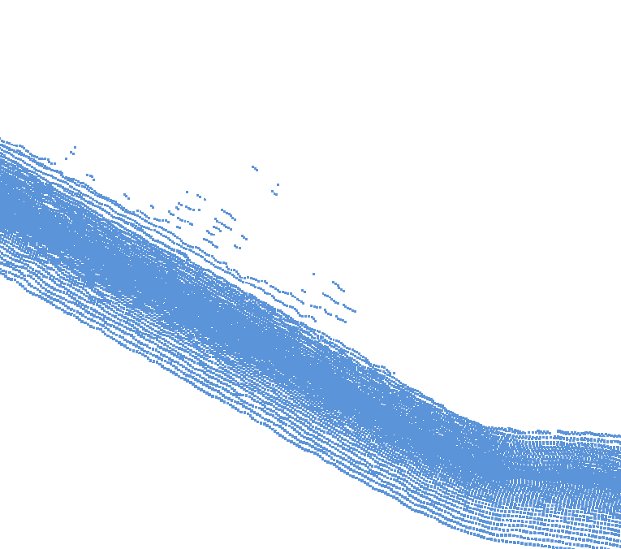 | 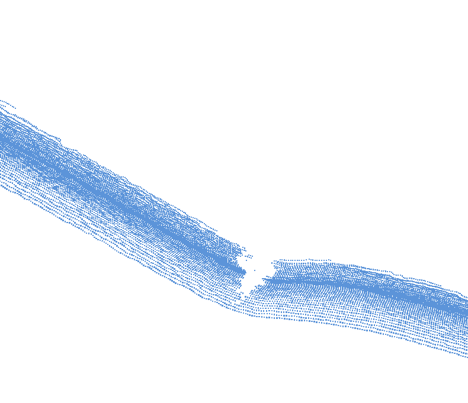 |
| ---- | ---- | ---- |
| Before (no changes) | After : 10 neighbour and 5 max distance | After : 100 neighbour and 0.5 max distance |  

<u>**Pros :**</u>
- We can see some results 

<u>**Cons :**</u>
- Too naive and not optimised
- Can erase no-outliers points
- Inefficient finding neighbour technique

<u>**Conclusion :**</u>  
This version is not robust enough to give it serious consideration. 

### Split data in lines :
To separate data as effectively as possible, I split data in LiDAR lines. This function read all data points in the order they appear in the tab. For each read point, I calculate the distance between this point and the next one. If a distance between 2 point is greater than the mean distance for this line multiply by delta, then this means we changed line. The line previously read is stocked as a line, and we continue until the end of all points.
Then, to display all line, we create multiple point cloud we are displaying in space. Each point cloud have its own color.  
The goal is to separate line to facilitate futur computations.  

<u>**Results :**</u>  

|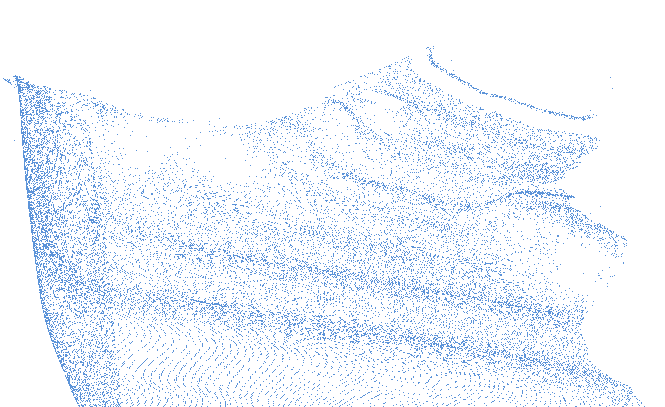 |  |  | 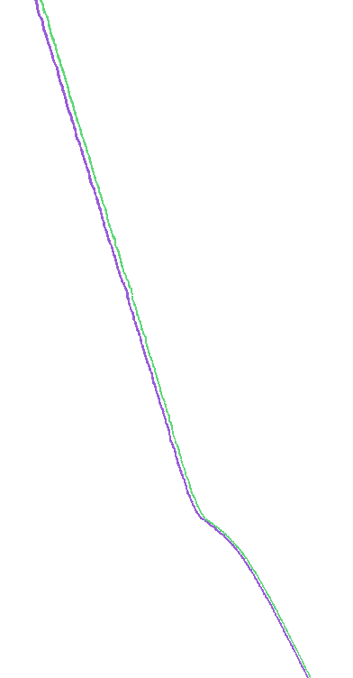 |  |
| ---- | ---- | ---- | ---- | ---- |
| Before (no changes) | After : delta = 7, 4489 lines found, focus on all datas (each color is a line) | After : delta = 4, 7010 lines found, focus on 2 lines | After : delta = 4, 7010 lines found, focus on 2 lines | After : delta = 4, 7010 lines found, focus on the first 5 lines (we can see really small lines in pink, blue and yellow) | 

<u>**Pros :**</u>
- Lines are well cut
- Quite fast

<u>**Cons :**</u>
- Can create really small lines, depending of the choosen delta (see fifth image)
- Can be hard to display with all lines as point cloud 

<u>**Conclusion :**</u>  
These splits in data will be useful and used in futur computation.

### Split data in clusters :
To again separate data as effectively as possible, I split data in clusters. To split in cluster, we use the algorithm **Kmean**. This algorithm first choose k points in our data set to initialize clusters. Then it apply Kmean algorithm few times (calculate barycenter, find wich is the closest barycenter for each point). Afterwards, it calculate, for each cluster, the mean distance between the barycenter and each point of the cluster. The number of clusters and the number of times kmean is applyed are decided by the user.   
Then, to display all clusters, we create multiple point cloud we are displaying in space. Each point cloud have its own color.  
The goal is to separate data into clusters to facilitate futur computations (parallelisation for exemple).  

<u>**Results :**</u>  

|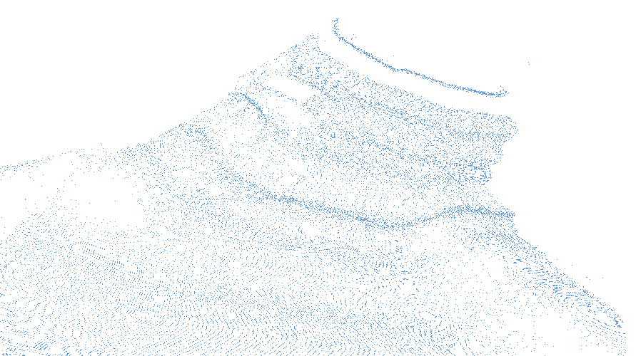 | 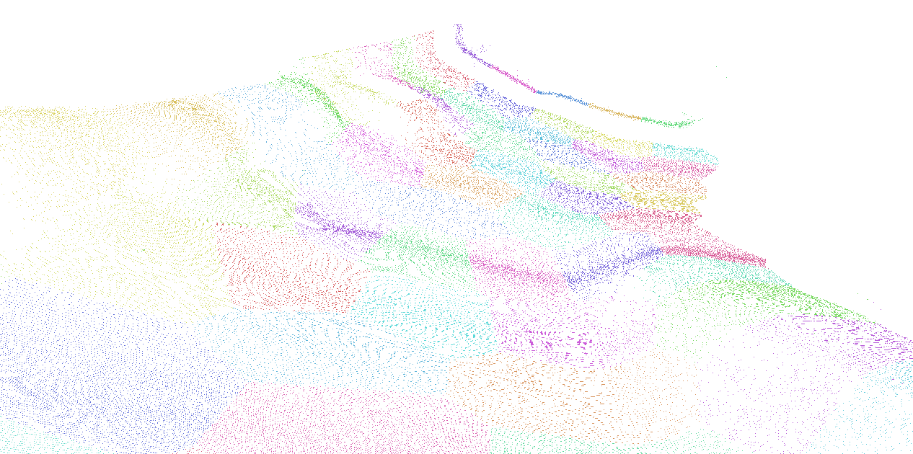 | 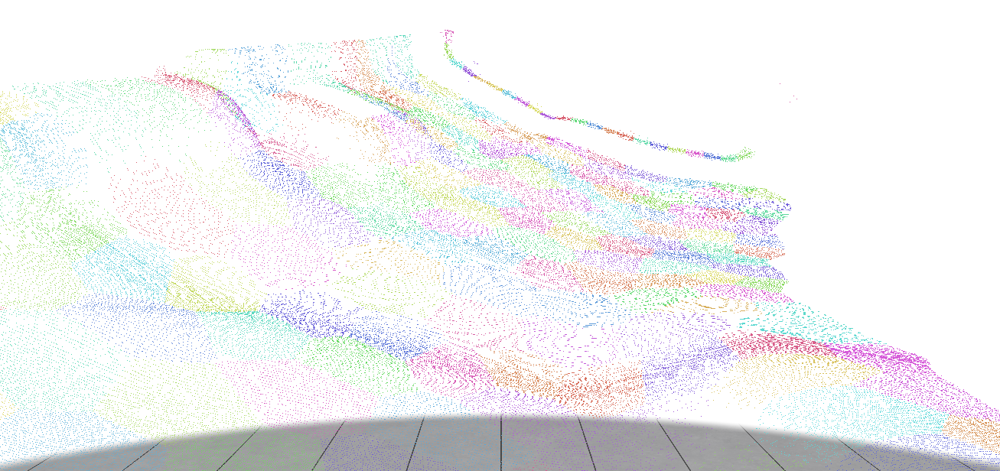 | 
| ---- | ---- | ---- | 
| Before (no changes) | After : k = 100, beta = 15 (each color is a cluster) | After : k = 400, beta = 15 (each color is a cluster) |

<u>**Pros :**</u>
- Clusters are well cut
- No missing data or weird cluster

<u>**Cons :**</u>
- Need parallelisation to be really fast if many clusters are computed
- Need to choose settings wisely 

<u>**Conclusion :**</u>  
These splits in data will be useful and used in futur computation.

### Cluster Filter 
This filter is the naive filter applyed on each cluster. The 'average point' is the barycenter of the cluster. We know the mean distance between this barycenter and each point of the cluster. If a point is too far from the barycenter, it's considered as an outlier and it's erased from point set. The number of clusters, the number of times kmean is applyed, and the maximum accepted distance are decided by the user.  
The goal is to erase isolated outliers.  

<u>**Results :**</u>  

|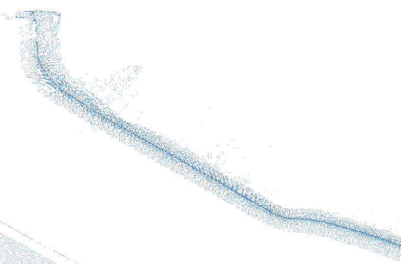 | 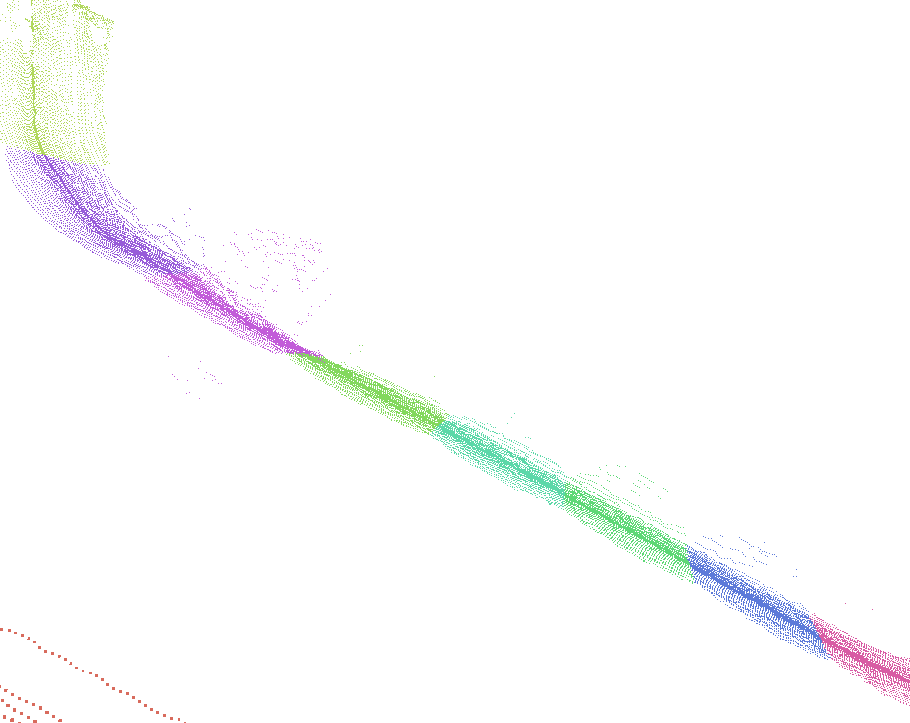 | 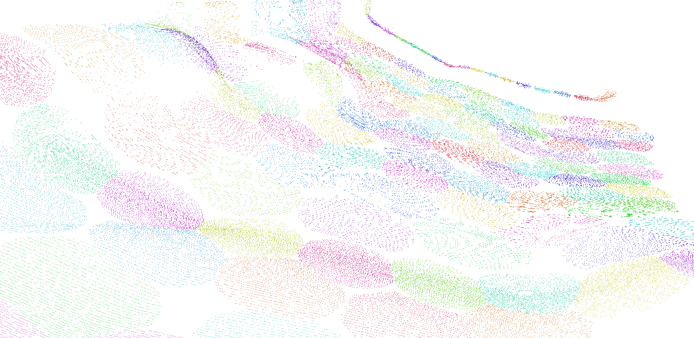 | 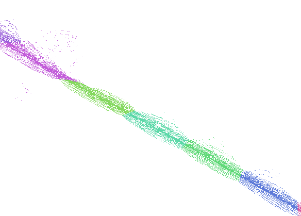 |  | 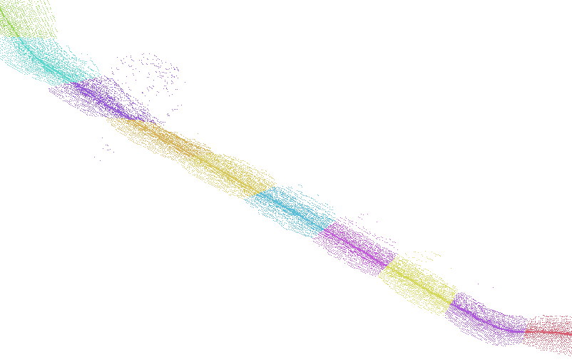 | 
| ---- | ---- | ---- | ---- | ---- | ---- | 
| Before (no changes) | After : k = 300, beta = 15, delta = 2.0 | After : k = 300, beta = 15, delta = 1.8, focus on all data (we can see it erase non-outliers point, wich create a "bubble" effet around barycenters) | After : k = 300, beta = 15, delta = 1.8 | After : k = 400, beta = 15, delta = 2.0, focus on all data | After : k = 300, beta = 15, delta = 1.8 |

<u>**Pros :**</u>
- Erase isolated outliers
- Finding neighbour technique is more efficient, therefore it's more robust than naive filter
- Can be parallelized to be faster

<u>**Cons :**</u>
- Can erase non-outliers points (see third image with the "bubble" effect)
- Need to choose settings wisely 

<u>**Conclusion :**</u>  
This filter is working and is interesting. Can be even faster if parallelized. Still not perfect tho.

### Other methods in progress ... 
